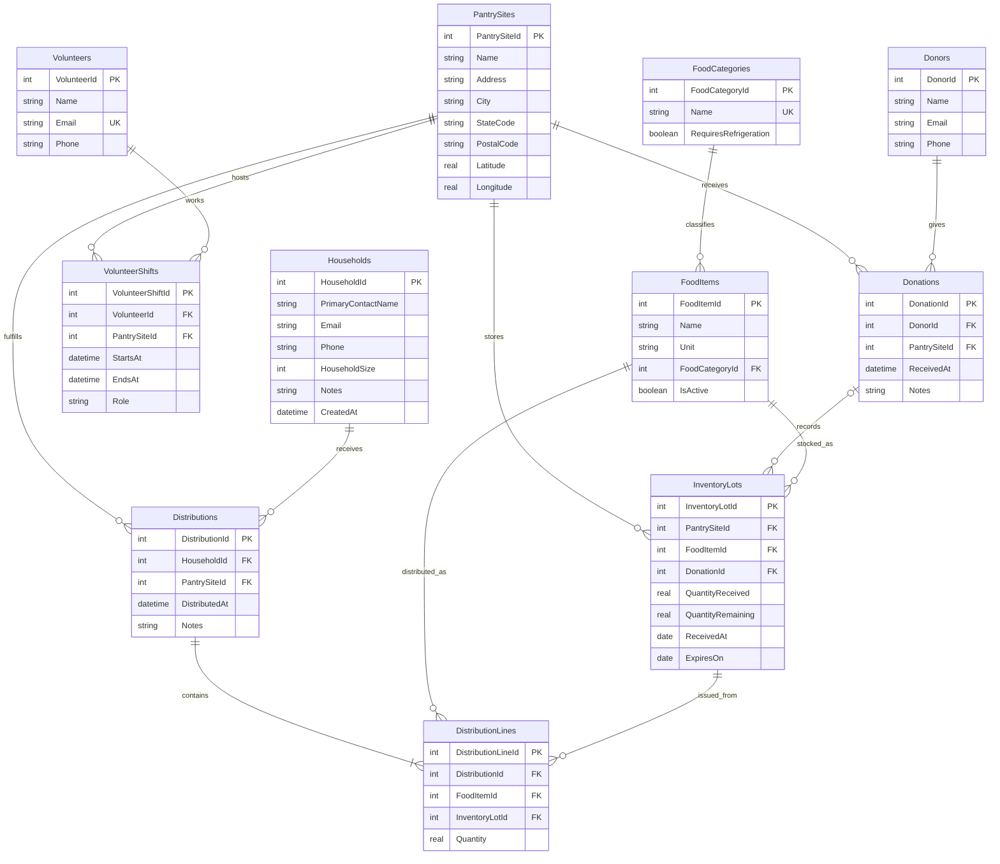

# Entity-Relationship Diagram

The diagram contains 11 tables. Each donated item/expiry batch is represented directly by an inventory lot linked to its donation header, avoiding duplicate donation-line and lot quantities. Distribution details resolve the distribution's one-to-many item relationship. `DistributionLines.InventoryLotId` preserves the exact source lot for each issued quantity, which supports reliable stock restoration and traceability.
